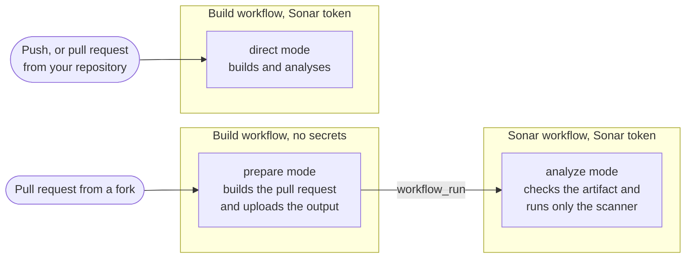

[](https://github.com/galois-groups/sonar-fork-analysis/actions/workflows/ci.yml)
[](https://sonarcloud.io/summary/new_code?id=galois-groups_sonar-fork-analysis)
[](https://sonarcloud.io/summary/new_code?id=galois-groups_sonar-fork-analysis)
[](https://scorecard.dev/viewer/?uri=github.com/galois-groups/sonar-fork-analysis)

---

<!-- prettier-ignore -->
> [!NOTE]
> v2 is under development and not released yet, so `@v2` doesn't resolve. This
> README describes v2.

Runs Sonar analysis, with coverage and test results, on pull requests from
forks.

GitHub doesn't give secrets to workflows triggered by a fork, so the usual Sonar
setup can't analyse their pull requests. This action splits the work in two. The
build workflow builds the pull request without the Sonar token. A second
workflow then analyses the result with the token, without running any of the
pull request's code. It's the split
[Sonar's documentation describes for forks](https://docs.sonarsource.com/sonarqube-cloud/analyzing-source-code/ci-based-analysis/github-actions-for-sonarcloud#analyzing-fork-pull-requests),
packaged for Maven, Gradle and any other project Sonar's scanner analyses, such
as JavaScript, TypeScript or Python. Binaries, libraries, coverage, test reports
and the settings your build defines all carry over.

If you don't need coverage on fork pull requests, SonarQube Cloud's
[Automatic Analysis](https://docs.sonarsource.com/sonarqube-cloud/advanced-setup/automatic-analysis/)
handles forks with no setup. It also doesn't support monorepos and analyses some
languages in less depth.

## Contents

- [Supported projects](#supported-projects-and-runners)
- [How it works](#how-it-works)
- [Setup](#setup)
- [Real-world examples](#real-world-examples)
- [Configuration](docs/configuration.md): inputs, required checks and recipes.
- [Security](docs/security.md): what the analysis trusts and how to harden your
  setup.
- [How it works in detail](docs/how-it-works.md)
- [Troubleshooting](docs/troubleshooting.md): what each message means.
- [Migrating from v1](docs/migrating-from-v1.md)
- [Contributing](CONTRIBUTING.md)
- [Reporting vulnerabilities](#reporting-vulnerabilities)
- [License](#license)

## Supported projects and runners

| Project                                                      | Supported | Tested |
| ------------------------------------------------------------ | --------- | ------ |
| Maven, Gradle                                                | Yes       | Yes    |
| npm, pnpm                                                    | Yes       | Yes    |
| Yarn with `nodeLinker: node-modules`, Bun                    | Yes       | No     |
| Yarn Plug'n'Play                                             | Yes¹      | No     |
| Python, Go, PHP and others with a `sonar-project.properties` | Yes²      | No     |
| .NET, C, C++ and Objective-C                                 | No³       | No     |

¹ Rules that need types find less: there's no `node_modules` to take them from.
`nodeLinker: node-modules` avoids it.

² Pull requests from forks only get them analysed once you turn their language
on. See
[languages on pull requests from forks](#languages-on-pull-requests-from-forks).

³ They need Sonar's scanner for .NET or Sonar's build wrapper.

### Languages on pull requests from forks

On pull requests from forks, the Sonar workflow only runs the analyzers of the
languages the sample projects test:

- Java and Kotlin;
- JavaScript, TypeScript and Vue;
- CSS, SCSS and HTML;
- XML, YAML and JSON: Maven POMs, GitHub Actions workflows, Kubernetes
  manifests, Helm charts and more;
- Dockerfiles and Containerfiles.

Sonar only loads a language's analyzer when it finds a file of that language.
The action asks Sonar which languages it knows. It then tells Sonar that no file
belongs to any of the others. Their files are still indexed, but with no
language. So their analyzer never runs. A pull request from a fork may then show
fewer issues than one of yours. It shows none for Python files in a Maven
project.

## How it works



## Setup

1. Create a Sonar token and save it as the repository secret `SONAR_TOKEN`.
   SonarQube Cloud's free plan only has personal tokens, so use a dedicated one
   named after your repository. Paid plans can use a
   [scoped organization token](https://docs.sonarsource.com/sonarqube-cloud/administering-sonarcloud/managing-organization/scoped-organization-tokens)
   with only _Execute analysis_ on the project. An expiry date is optional, but
   a token without one is removed after 60 days without use.
2. Gradle builds need the `org.sonarqube` plugin, 2.1 or later. Maven builds
   need nothing: the action runs the latest `sonar-maven-plugin` or the version
   your pom pins in `<plugins>` or `<pluginManagement>`, which must be 3.2 or
   later. Dependabot can keep either up to date.
3. Add the action to your build workflow:

   ```yaml
   name: Build
   on:
     push:
       branches: [main]
     pull_request:
   permissions:
     contents: read
   jobs:
     build:
       runs-on: ubuntu-latest
       steps:
         # Your existing checkout and Java setup. Sonar needs the full history.
         - uses: actions/checkout@v7
           with:
             persist-credentials: false
             fetch-depth: 0
         - uses: actions/setup-java@v6
           with:
             distribution: temurin
             java-version: 21
         # Add this in place of your build step.
         - uses: galois-groups/sonar-fork-analysis@v2
           with:
             project-key: my-org_my-project
             sonar-organization: my-org
             sonar-token: ${{ secrets.SONAR_TOKEN }}
   ```

   The action runs the build itself, `verify` for Maven and `check` for Gradle
   (see [`build-goals`](docs/configuration.md#inputs)). Trigger the workflow on
   `pull_request`, not `pull_request_target`. With `pull_request_target`, a
   fork's code would run with your secrets, so the action refuses to build
   there.

4. Add the Sonar workflow, triggered by the build:

   ```yaml
   name: Sonar
   on:
     workflow_run:
       workflows: [Build]
       types: [completed]
   jobs:
     sonar:
       if: github.event.workflow_run.conclusion == 'success'
       runs-on: ubuntu-latest
       permissions:
         actions: read
         contents: read
         pull-requests: read
         statuses: write
       steps:
         - uses: galois-groups/sonar-fork-analysis@v2
           with:
             project-key: my-org_my-project
             sonar-organization: my-org
             sonar-token: ${{ secrets.SONAR_TOKEN }}
   ```

   Use the same `project-key` in both workflows, because it also names the
   artifact. `statuses: write` is optional, see
   [commit statuses](docs/configuration.md#commit-statuses-and-required-checks).

If you pin your other actions to commit SHAs, pin this one too. The
[security page](docs/security.md#hardening-your-setup) has more hardening
advice.

### Other projects

For other projects, such as JavaScript, TypeScript, Python, Go or PHP, add the
action after your own build and test steps. The action doesn't build anything.
It runs Sonar's scanner, which reads its settings from your
`sonar-project.properties`, just like Sonar's own scan action. The action
recognises these projects by that file or by a `package.json`. For a Node
project:

```yaml
steps:
  # Your existing checkout and Node setup. Sonar needs the full history.
  - uses: actions/checkout@v7
    with:
      persist-credentials: false
      fetch-depth: 0
  - uses: actions/setup-node@v7
    with:
      node-version: 24
  - run: npm ci
  # Write coverage where sonar-project.properties says, e.g. coverage/lcov.info.
  - run: npm test -- --coverage
  # Add this after your tests.
  - uses: galois-groups/sonar-fork-analysis@v2
    with:
      project-key: my-org_my-project
      sonar-organization: my-org
      sonar-token: ${{ secrets.SONAR_TOKEN }}
```

```properties
sonar.sources=src
sonar.tests=test
sonar.javascript.lcov.reportPaths=coverage/lcov.info
```

Other languages have their own report settings, such as
`sonar.python.coverage.reportPaths=coverage.xml` for Python. Pull requests from
forks only get Python analysed once you turn it on. See
[languages on pull requests from forks](#languages-on-pull-requests-from-forks).
For a Node project, the action also passes the type declarations in your
`node_modules` to the Sonar workflow, along with the links your package manager
makes there. Rules that need types then work on pull requests from forks too,
even across the packages of a monorepo.

## Real-world examples

[Instancio](https://github.com/instancio/instancio) analyses its pull requests
from forks with this action, on a Maven build with 38 modules. See its
[build workflow](https://github.com/instancio/instancio/blob/main/.github/workflows/build.yml)
and
[Sonar workflow](https://github.com/instancio/instancio/blob/main/.github/workflows/sonar.yml).

This repository analyses itself with the action too. It's a TypeScript project
that runs the scanner after its tests, with a `sonar-project.properties` file.
See its [build workflow](.github/workflows/ci.yml) and
[Sonar workflow](.github/workflows/sonar.yml).

## Reporting vulnerabilities

Report vulnerabilities as described in [SECURITY.md](SECURITY.md). How the
action protects your token is explained in [security](docs/security.md).

## License

[MIT](LICENSE).

This project is not affiliated with or endorsed by SonarSource. Sonar, SonarQube
and SonarCloud are trademarks of SonarSource.
