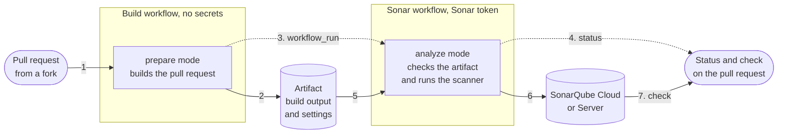
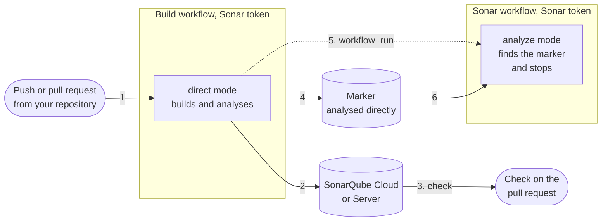

# How it works

This page explains how the action analyses pull requests from forks without
exposing the Sonar token. It also explains how this project tests that. The
[security](security.md) page covers what a fork can still influence and how to
harden your setup.

## The two workflows

GitHub starts the Sonar workflow each time the build workflow completes. What
the two do depends on where the change comes from.

### Pull requests from forks

1. The pull request starts your build workflow. It runs without the Sonar token.
   For Maven and Gradle, the action runs the build. For other projects, it runs
   after your own build and tests. Then Sonar's own tool works out the analysis
   settings without running the analysis: the Maven or Gradle plugin, the npm
   scanner for a Node project and Sonar's scanner for a project with only a
   `sonar-project.properties`.
2. The action uploads the settings and what the analysis needs as an artifact.
   An artifact is a set of files GitHub keeps with the run. This one holds
   compiled classes, libraries, coverage and test reports. For a Node project,
   it also holds the type declarations from `node_modules`.
3. When the build finishes, GitHub starts your Sonar workflow through
   `workflow_run`. It runs in your repository and has the Sonar token.
4. Once the action finds the build's artifact, it posts a pending status on the
   pull request if the job has `statuses: write`. The status turns to success or
   failure when the analysis ends.
5. The action checks out the pull request and downloads the artifact. It checks
   the artifact's settings against an allowlist.
6. The action runs Sonar's scanner on the sources and the build output. The
   scanner sends the analysis to the server. Nothing from the pull request runs.
7. Sonar posts its check on the pull request as usual.

### Your own pushes and pull requests

1. The push or pull request starts your build workflow. It has the Sonar token.
2. The action builds and analyses straight away. It works like Sonar's own
   plugins and scanner.
3. On a pull request, Sonar posts its check as usual.
4. The action uploads a small artifact as a marker of the direct analysis.
5. When the build finishes, GitHub starts your Sonar workflow anyway.
6. The action finds the marker and stops. It posts no status.

Dependabot's pull requests run without your Actions secrets, like forks, so they
take the fork path too.

You don't have to pick any of this. The `mode` input defaults to `auto`, which
picks the mode from the event and whether there's a token.

## Settings from the build

On the fork path, the build collects its settings without running the analysis.
It uses simulation mode (`sonar.scanner.internal.dumpToFile`), a feature of
Sonar's plugins for Maven and Gradle, of its npm scanner and of the scanner the
action pins. Sonar uses it in its own tests but doesn't document it. So a
release could change it. If it stops working, the build fails with a message
that no analysis settings were written. This project's tests keep up with the
latest plugins and npm scanner, so such a change should show up here first.

The npm scanner writes its settings in a format of its own, which the action
converts. Before it writes them, it would ask the server for its version, its
Java and its engine. The action skips all three, so from `@sonar/scan` 5.0.0 on,
the npm scanner needs no server at all. Older versions still download the engine
first.

## What the Sonar workflow does

It never runs Maven, Gradle, npm or a wrapper script. It checks out the pull
request, unpacks the artifact and runs Sonar's scanner. The scanner reads the
pull request's files but never runs them. Most of its work happens in Sonar's
engine, which the scanner downloads from the server. The engine runs one
analyzer per language.

### The checkout

If the workspace is empty, the action checks out the pull request itself,
without ever writing the GitHub token to disk. `origin` points at your
repository, because that's where Sonar looks for the base branch. The pull
request's commit comes from your repository too. GitHub keeps a copy of every
pull request's head there. The action never contacts the fork. At the end of the
job, the action deletes its checkout, so the pull request's code doesn't stay on
a self-hosted runner.

If a step before the action already checked out, the action uses that checkout
and leaves it in place. It checks that the checkout is at the analysed commit,
with full history and no stored credentials. `origin` must be your repository.
The workspace must hold nothing the commit doesn't have.

Then the action removes two kinds of files the scanner would otherwise trust:

- Links that lead outside the checkout, because the scanner follows them. A link
  to `/proc/self` would get the scanner's own environment indexed and sent to
  Sonar. That environment holds the token. A link could hide behind a file name
  that isn't valid UTF-8, so the action refuses such names.
- `sonar-project.properties` files, because the scanner would read them as
  configuration.

### The artifact

The action refuses an artifact that holds links, special files or file names
that aren't valid UTF-8. It unpacks the build output next to the sources. It
never writes over an existing file or through a link. It adds only two kinds of
files to the source directories:

- the report files that the analysis settings point to;
- type information in `node_modules`: declarations, `package.json` and
  `tsconfig` files.

The analyzers read the type information only to learn the types the code uses.
By default, Sonar's JavaScript analyzer reports no issues in it: it skips
`node_modules` and `.d.ts` files.

Through a link or a report setting, a fork can still add files that Sonar
analyses as part of its code. That only changes its own pull request's results,
as committing those files would.

The action also recreates the links a Node project had in `node_modules`. It
only recreates links that sit in a `node_modules` directory and lead to a
directory in the checkout, never into `.git`. A fork could commit links like
these itself.

### The settings

The build's settings go through the same
[allowlist](#what-the-fork-path-carries) again. Every path in them must lead
inside the checkout or into the action's private home. That's where the action
puts libraries from the build's home directory, such as Maven's `~/.m2`. The
action also drops any value the scanner might read differently from how it was
checked. The main example is a `${…}` placeholder: the scanner expands those, so
`${env.SONAR_TOKEN}` would turn into the token. Quotes, control characters, path
patterns and stray spaces are dropped for the same reason. The action works out
the modules the same way the engine does. Each module needs its own base
directory inside the checkout.

Some settings matter for safety. The action always sets those itself. The
artifact can't change them:

- the project key;
- the analysed commit;
- the working directory;
- which languages are analysed;
- the [features that stay off](security.md#what-stays-off-on-the-fork-path).

### The analyzers

On the fork path, only the analyzers of the
[tested languages](../README.md#languages-on-pull-requests-from-forks) run. The
engine loads most analyzers only once it finds a file of their language. It runs
each analyzer only on those files. So the action asks the server which languages
it knows. For each language that isn't tested, it sets
`sonar.lang.patterns.<language>` to a pattern no file can match. Files of those
languages are still indexed, but without a language. Their analyzers never load
in the job that has the token.

Without the server's list, the action can't know which languages to turn off. So
if it can't get the list, it stops without analysing. All this relies on how the
engine behaves. A new engine could change that. This project's tests check it
against the engines of SonarQube Cloud and SonarQube. See
[how it's tested](#how-its-tested).

Sonar's plugin for infrastructure as code (`iac`) always loads. It finds some
YAML and JSON files by their content: CloudFormation templates, Ansible
playbooks, Azure Pipelines files and ARM templates. The sample projects hold one
of each, so these are tested languages like the others.

The analyzers of the tested languages only read the project's files. They never
run them. The sample projects check this on every change, against SonarQube
Cloud's analyzers. Their analyses run among traps: fake programs and
booby-trapped project files. A trap fails the run if an analyzer starts one of
those programs or loads one of those files. Any program an analysis starts must
also be on a list of known ones. See [how it's tested](#how-its-tested).

The JavaScript analyzer got a closer look, because JavaScript projects hold a
lot of configuration that is code. A project that tried every way to get its own
code run showed that the analyzer uses its own Node.js and TypeScript. It ran
none of the project's configuration files (ESLint, Babel, TypeScript and others)
and loaded no code from its `node_modules`. It only read `tsconfig` files and
type declarations as data.

Sonar starts programs of its own to analyse some languages. One handles shell
scripts, PowerShell and Mule applications. Another handles Helm charts. Like the
JavaScript analyzer's Node.js, they run among the traps on every change.

Analyzers of other languages haven't been checked. Some might start other
programs. If you turn their language on with `build-arguments`, the action
guarantees nothing for them.

### The scanner

The scanner runs in an empty directory of its own. Its environment holds the
Sonar token, but not the action's inputs, the runner's own tokens or variables
like `GITHUB_ENV`. That limits what a mistake can reach, but it isn't a security
boundary: a program running there could still read the action's own environment.

## What the fork path carries

The build only passes on the settings an analysis needs, picked by name:

- the project's structure: modules, sources, tests, binaries and libraries;
- the paths of reports: coverage, tests and external issues;
- per-language settings;
- exclusions.

Everything else stays behind:

- the server, the token and the project key;
- scanner and branch settings;
- anything that would start a program, like a JDBC driver or Node.js;
- the settings that decide each file's language: file suffixes and patterns, and
  `sonar.lang.patterns.*`. The Sonar workflow sets its own, see
  [the analyzers](#the-analyzers).

Reports are recognised by their name (`…reportPaths` and similar), so a report
from a tool Sonar adds later works without a new release of this action. The
action checks settings ending in `Paths` one entry at a time. That assumes the
scanner reads them as lists, which every documented one does.

The filtering can produce two warnings:

- _The analysis of pull requests leaves out these settings_ comes from the build
  when it leaves something behind. If the analysis needs it, pass it with
  `build-arguments` in the Sonar workflow. That's your own configuration, so
  it's trusted.
- _Dropped settings a build never ships_ comes from the Sonar workflow when the
  artifact holds a setting no build would produce. Either someone tampered with
  the artifact or the two workflows run different versions of the action.

## How it's tested

Sonar updates its scanner and engine on its own schedule. SonarQube Cloud uses a
new engine as soon as Sonar releases it, with no change on your side. Some of
these updates matter for safety. Dependency analysis, build-system
autoconfiguration and the engine's habit of running `dotnet` to collect
analytics all came in updates like these.

So this project tests against the real scanner and engines on every pull request
and once a week. It uses the scanner CLI it pins and the engines that SonarQube
Cloud and the latest SonarQube Community Build currently serve. The tests check
that:

- the scanner reads settings exactly as the action checked them;
- the engine builds the same modules as the action;
- no part of the engine beyond the reviewed ones can start a program.

For [turning languages off](#the-analyzers), they also check that:

- a language's `sonar.lang.patterns` setting replaces its own patterns;
- the pattern that turns a language off matches no file;
- the engine loads analyzers only for the languages it finds.

The analyses of the sample projects also set traps. These analyses run against
SonarQube Cloud only. Before the Sonar workflow analyses them, it puts fakes of
these programs on the `PATH`:

- the build tools of Maven, Gradle, Node, Python, Go, Rust and Scala;
- Java, `wget` and `curl`, which the Maven and Gradle wrappers need;
- `docker`, `podman`, `kubectl` and `helm`;
- the tools of Terraform, Ansible, AWS, Azure, shell scripts and PowerShell:
  `terraform`, `tofu`, `ansible`, `ansible-playbook`, `ansible-lint`,
  `cfn-lint`, `aws`, `az`, `bicep`, `shellcheck`, `pwsh` and `powershell`;
- `dotnet`, except in the scanner's own directory. SonarQube Cloud's engine runs
  it there to collect analytics.

Each fake fails the run if anything starts it. The sample projects add traps of
their own: Gradle settings, Node configuration files and Node packages. These
fail the run if the analysis ever loads them.

The fakes only catch programs known by name, so the Linux kernel also records
every program the scanner starts, at any depth. A separate job without the token
compares them with the programs the scanner, the engine and the analyzers are
known to start. Any other program fails the run. A container started anywhere on
the machine during the analysis fails it too. The record only shows which
programs start, not what a program does once it runs.

One sample project also holds a Python file with a known issue. It checks that
untested languages stay off on the fork path. The direct analysis must report
the issue, but the fork path must not analyse the file.

Older SonarQube Server versions and commercial editions aren't tested.
