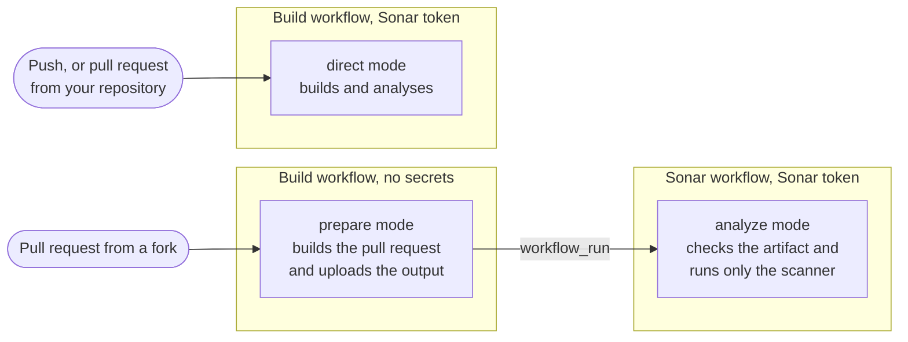

# How it works

This page explains how the action analyses pull requests from forks without
exposing the Sonar token, and how this project tests that. For what's left to
you, see [security](security.md).

## The two workflows

On a pull request from a fork:

1. Your build workflow runs without the Sonar token. For Maven and Gradle, the
   action runs the build. Sonar's build plugin then works out the analysis
   settings, without running the analysis. For other projects, the action runs
   after your own build and tests, and reads your `sonar-project.properties`.
   Either way, it uploads the settings and what the analysis needs as an
   artifact. An artifact is a set of files GitHub keeps with the run. This one
   holds compiled classes, libraries, coverage and test reports. For a Node
   project, it also holds the type declarations from `node_modules`.
2. When the build finishes, GitHub starts your Sonar workflow through
   `workflow_run`. It runs in your repository, so it has the Sonar token.
3. The action checks out the pull request, checks the artifact's settings
   against an allowlist and runs Sonar's scanner on the sources and the build
   output. It never runs the build or anything else from the pull request. Sonar
   shows the results on the pull request as usual.

On pushes and pull requests from your own repository, the build has the token.
So the action analyses straight away, as Sonar's own plugins and scanner would.
The Sonar workflow still starts after the build, but has nothing to do.

Dependabot's pull requests run without your Actions secrets, like forks, so they
take the fork path too.

You don't have to pick any of this. The `mode` input defaults to `auto`, which
picks the mode from the event and whether there's a token.

## Settings from the build

On the fork path, the build collects its settings without running the analysis.
It uses simulation mode (`sonar.scanner.internal.dumpToFile`), a feature of
Sonar's plugins for Maven and Gradle and of the scanner the action pins. Sonar
uses it in its own tests but doesn't document it. So a release could change it.
If it stops working, the build fails with a message that no analysis settings
were written. This project's tests keep up with the latest plugins, so such a
change should show up here first.

## What the Sonar workflow does

It never runs Maven, Gradle, npm or a wrapper script. It checks out the pull
request, unpacks the artifact and runs Sonar's scanner. The scanner reads the
pull request's files but never runs them. Most of its work happens in Sonar's
engine, which the scanner downloads from the server. The engine runs one
analyzer per language.

### The checkout

The action checks out the pull request itself, without ever writing the GitHub
token to disk. `origin` points at your repository, because that's where Sonar
looks for the base branch. The pull request's commit comes from your repository
too. GitHub keeps a copy of every pull request's head there. The action never
contacts the fork. Then it removes two kinds of files the scanner would
otherwise trust:

- Links that lead outside the checkout. The scanner follows them. So a link to
  `/proc/self` would get the scanner's own environment indexed and sent to
  Sonar, and that environment holds the token. A link could hide behind a file
  name that isn't valid UTF-8, so the action refuses such names.
- `sonar-project.properties` files, which the scanner would read as
  configuration.

### The artifact

The action refuses an artifact that holds links, special files or file names
that aren't valid UTF-8. It unpacks the build output next to the sources. It
never writes over an existing file or through a link. Into the source
directories it only adds two kinds of files: the reports the settings name, and
type information in `node_modules` (declarations, `package.json` and `tsconfig`
files).

Through a link or a report setting, a fork can still add files that Sonar
analyses as part of its code. That only changes its own pull request's results,
as committing those files would. The analyzers read the type information to
learn the types the code uses. By default they never report on it as part of the
project.

The action also recreates the links a Node project had in `node_modules`. It
only recreates links that sit in a `node_modules` directory and lead to a
directory in the checkout, never into `.git`. A fork could commit links like
these itself.

### The settings

The build's settings go through the same
[allowlist](#what-the-fork-path-carries) again. Every path in them must lead
inside the checkout or into the action's private home. That's where the action
puts libraries from the build's home directory, such as Maven's `~/.m2`. The
action also drops any value the scanner might read differently from how it was
checked. The main example is a `${…}` placeholder: the scanner expands those, so
`${env.SONAR_TOKEN}` would turn into the token. Quotes, control characters, path
patterns and stray spaces are dropped for the same reason. The action works out
the modules the same way the engine does. Each module needs its own base
directory inside the checkout.

Then the action sets the settings that matter for safety itself, whatever the
artifact says: the project key, the analysed commit, the working directory, the
languages it analyses and the
[features that stay off](security.md#what-stays-off-on-the-fork-path).

### The analyzers

On the fork path, only the analyzers of the
[tested languages](../README.md#languages-on-pull-requests-from-forks) run. The
engine only runs a language's analyzer on files of that language. It loads most
analyzers only once it finds such a file. So the action asks the server which
languages it knows. For each of the others, it sets
`sonar.lang.patterns.<language>` to a pattern no file can match. Files of those
languages are still indexed, with no language. Their analyzers never run in the
job that has the token. If the server doesn't list its languages, the analysis
stops. The tests check the engine habits this relies on. They run against
SonarQube Cloud's engine and SonarQube's.

Sonar's plugin for infrastructure as code (`iac`) always loads. It recognises
some YAML and JSON files by their content, such as CloudFormation and Ansible
files. Turning languages off doesn't stop that. That plugin only reads files.

The analyzers of the tested languages only read files. For JavaScript and
TypeScript, this was tested against Sonar's real analyzer with a project that
tried every way to get its own code run. The analyzer used its own Node.js and
TypeScript. It ran none of the project's configuration files (ESLint, Babel,
TypeScript and others) and loaded no code from its `node_modules`. It only read
`tsconfig` files and type declarations as data. Two Node sample projects keep
checking this against SonarQube Cloud's analyzer: one installed with npm and one
with pnpm. See [how it's tested](#how-its-tested). Analyzers for other languages
haven't been checked. Some might start other programs. If you turn their
language on with `build-arguments`, the action guarantees nothing for them.

### The scanner

The scanner runs in an empty directory of its own. Its environment holds the
Sonar token, but not the action's inputs, the runner's own tokens or variables
like `GITHUB_ENV`. That limits what a mistake can reach. But it isn't a security
boundary: a program running there could still read the action's own environment.

## What the fork path carries

The build only passes on the settings an analysis needs, picked by name:

- the project's structure: modules, sources, tests, binaries and libraries;
- the paths of reports: coverage, tests and external issues;
- per-language settings;
- exclusions.

Everything else stays behind:

- the server, the token and the project key;
- scanner and branch settings;
- anything that would start a program, like a JDBC driver or Node.js;
- the settings that decide each file's language: file suffixes and patterns, and
  `sonar.lang.patterns.*`. The Sonar workflow sets its own, see
  [the analyzers](#the-analyzers).

Reports are recognised by their name (`…reportPaths` and similar), so a report
from a tool Sonar adds later works without a new release of this action. The
action checks settings ending in `Paths` one entry at a time. That assumes the
scanner reads them as lists, which every documented one does.

The filtering can produce two warnings:

- _The analysis of pull requests leaves out these settings_ comes from the build
  when it leaves something behind. If the analysis needs it, pass it with
  `build-arguments` in the Sonar workflow. That's your own configuration, so
  it's trusted.
- _Dropped settings a build never ships_ comes from the Sonar workflow when the
  artifact holds a setting no build would produce. Either someone tampered with
  the artifact, or the two workflows run different versions of the action.

## How it's tested

Sonar updates its scanner and engine on its own schedule. Some updates matter
here: dependency analysis, build-system autoconfiguration and the engine's habit
of running `dotnet` to collect analytics all arrived that way.

So this project tests against the real thing, on every pull request and once a
week: the scanner CLI it pins, together with the engines that SonarQube Cloud
and the latest SonarQube Community Build currently serve. The tests check that
the scanner reads settings exactly as the action checked them, that the engine
builds the same modules and that no part of the engine beyond the reviewed ones
can start a program. They also check three habits of the engine. A language's
`sonar.lang.patterns` setting replaces its own patterns. The pattern that turns
a language off matches no file. The engine loads analyzers only for the
languages it finds.

The analyses of the sample projects also set traps. Fake build tools on the
`PATH` fail the run if the analysis ever starts one. The Maven and Gradle
wrappers need Java, `wget` and `curl`, so fakes of these fail the run too. So do
booby-trapped Gradle settings. The Node sample projects add booby-trapped
configuration files and packages, which fail the run if the JavaScript analyzer
ever loads them. One sample project also holds a Python file. The direct
analysis must report its issue. The fork path must not analyse it.

Older SonarQube Server versions and commercial editions aren't tested.
